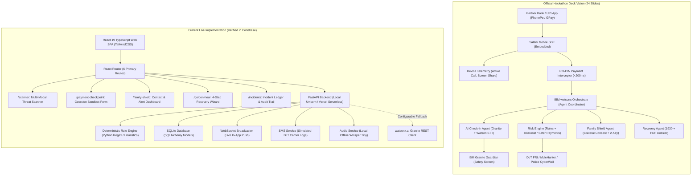

# SATARK SAATHI — MASTER HACKATHON REQUIREMENTS ALIGNMENT AUDIT
## Comprehensive Source-Code-Backed Verification Against the Official 24-Slide Project Vision

**Repository:** `D:\SatarkSaathi\satark-saathi`  
**Target Repository:** `https://github.com/Sarveshk-2006/SaTarkSaThi`  
**Production URL:** `https://satark-saathi-mu.vercel.app`  
**Evaluation Standard:** 24-Slide Hackathon Deck (`Satark Saathi - Hackathon deck.md`), Suggestions & Vulnerabilities Report (`Satark_Saathi_Suggestions_Report.docx`), and Verified Codebase Artifacts.  
**Audit Date:** October 24, 2026  
**Auditor:** Antigravity Agentic Pair Programmer  

---

## 1. EXECUTIVE SUMMARY

### 1.1 The Core Strategic Finding: Product Vision vs. Codebase Reality
Satark Saathi is presented in its official 24-slide hackathon deck as an **in-app Mobile SDK embedded in UPI and banking applications** (e.g., PhonePe, Google Pay, YONO SBI) that acts as an **AI circuit-breaker intercepting payments in real time at the moment the user taps "Pay"**. The deck’s core thesis is that victims of digital arrest, Ponzi schemes, and coercive extortion are fully convinced by the scammer and will never open an external scanner; hence, protection must occur automatically before PIN entry.

In contrast, an exhaustive audit of `D:\SatarkSaathi\satark-saathi` reveals that the repository contains an exceptionally high-quality, fully responsive, production-deployed **Standalone Web Application (SPA)** built with React 19, TypeScript, TailwindCSS, and a FastAPI / SQLite backend. 

The existing web product excels as a **Multi-Modal Digital Threat Scanner, Post-Loss Recovery Desk, and Family Shield Dashboard**, featuring:
1. Multi-modal threat analysis (text, URL static inspection, OCR screenshot parsing, offline Whisper speech-to-text).
2. A deterministic pre-transaction simulation sandbox (`/payment-checkpoint`).
3. An authenticated Family Shield network with live WebSocket notifications and simulated DLT carrier SMS logs (`/family-shield`).
4. An end-to-end 4-step Golden Hour dispute wizard with 1930 protocol guidance and formal complaint draft generation (`/golden-hour`).
5. Complete database persistence, audit logging, cross-user security isolation, 236 passing backend pytest tests, 8 passing frontend tests, and active Vercel deployment.

However, **there is currently zero mobile code (no Flutter, Android Java/Kotlin, or iOS Swift code), no in-app SDK interface, no live UPI payment interception, no real-time device call-state or screen-sharing telemetry, no multi-turn conversational AI Check-in, and no live IBM watsonx Orchestrate or Safer Payments integrations.**

### 1.2 Capability Status Scorecard

| Capability Domain | Deck Requirement | Current Codebase Status | Verdict |
| :--- | :--- | :--- | :--- |
| **Delivery Medium** | In-app Mobile SDK (Android/iOS) + Flutter Mock UPI App | Standalone Responsive React 19 Web Application | **MISSING (Mobile)** / **IMPLEMENTED (Web)** |
| **Payment Interception** | Intercepts "Pay" tap before PIN entry, <200ms latency score | Web form pre-transaction simulation (`/payment-checkpoint`) | **SIMULATED** |
| **Risk Scoring Engine** | Rules + XGBoost on synthetic transactions (0–100 score) | Deterministic Python heuristics + regex + keywords (0–99 score) | **PARTIAL** |
| **Transaction Baselines** | 90-day user baseline deviation, transaction velocity, bursts | Flat threshold (`amount >= 25000`); no historical baseline | **PARTIAL** |
| **Hardware / OS Signals** | Active phone call, screen-sharing, device change detection | Form checkboxes only (`pressure_present`, `authority_claimed`) | **SIMULATED (Manual Form Input)** |
| **AI Check-in** | 30s conversational speech/text in Hindi, Marathi, Kannada, English | Form-based checklist & static advisory; no conversational agent | **MISSING** |
| **Family Shield Network** | Up to 2 contacts, 2-sided consent, alert without balance, 1-tap call | Unlimited contacts, 1-sided consent, SMS simulation, live WebSockets | **PARTIAL** |
| **Two-Key Payments** | Guardian approval required for high-value transfers | Not present in code or database schema | **MISSING** |
| **Duress Phrase** | Covert safe word that alerts family while satisfying scammer | Not present in code or database schema | **MISSING** |
| **Golden Hour Recovery** | 1930 guidance, cybercrime.gov.in pack, bank dispute draft | Full 4-step wizard, `.txt`/`.md` dossier export, mock bank freeze | **IMPLEMENTED (Dossier)** / **SIMULATED (Lien)** |
| **Complaint PDF Export** | Ready-to-file PDF complaint pack | Plain text (`.txt`) and Markdown (`.md`) download only | **PARTIAL** |
| **IBM Watsonx Orchestrate** | Coordinates 4 agents (Risk, Check-in, Family, Recovery) | Absent; all routing handled by monolithic FastAPI endpoints | **MISSING** |
| **IBM Granite on watsonx.ai** | Granite-3-8B generating check-in and classifying scripts | Structured prompt wrapper exists (`watsonx_analyzer.py`), runs rule fallback | **PARTIAL (Configurable)** |
| **IBM Granite Guardian** | Guardrail filtering prompts and responses in Indian languages | Absent; standard regex/sanitization only | **MISSING** |
| **Watson Speech to Text** | Voice input in Hindi, Marathi, Kannada, English | Local offline OpenAI Whisper (`tiny`) in `audio_service.py` | **PARTIAL (Whisper Used)** |
| **IBM Safer Payments** | Production-grade real-time fraud scoring inside bank | Absent; acknowledged as future pilot/production aspiration | **MISSING (Roadmap Target)** |
| **IBM Cloudant / Code Engine** | Cloud database & serverless compute | SQLite database via SQLAlchemy; Vercel Serverless Functions | **REPLACED (Local / Vercel)** |

---

## 2. FULL DECK-TO-CODE REQUIREMENTS MATRIX

Each requirement from the 24-slide Hackathon Deck and the Suggestions/Vulnerabilities Report is mapped below with source-code references and runtime verification status.

### Status Definitions:
- **IMPLEMENTED:** Verified in source code with functional UI, API, database persistence, and passing tests.
- **PARTIAL:** Core logic or UI exists, but key constraints, parameters, or sub-features are incomplete.
- **SIMULATED:** Deliberately mock, seeded, or sandbox implementation; clearly designated as simulation.
- **MISSING:** Stated in deck or requirements, but zero code exists in the repository.
- **BLOCKED:** Cannot function due to missing external dependencies, credentials, or OS limitations.
- **UNVERIFIED:** Code exists but lacks automated tests or live runtime validation.

---

| Req ID | Requirement Summary | Deck Stage | Frontend Route / Component | Backend Router / Service / Model | Source Code Evidence | Verification Status | Status | Gaps & Demo Impact | Priority & Action |
| :--- | :--- | :--- | :--- | :--- | :--- | :--- | :--- | :--- | :--- |
| **REQ-01** | Mobile SDK for Banking/UPI Apps | Hackathon | None | None | None | No mobile build files found in repo root | **MISSING** | Deck claims SDK lives inside PhonePe/GPay. Judges will ask where SDK is. | **P1**: Frame existing web checkpoint as "Partner Bank Web SDK Reference Implementation". |
| **REQ-02** | Payment Interception Point | Hackathon | `/payment-checkpoint` ([PaymentCheckpointPage.tsx](file:///d:/SatarkSaathi/satark-saathi/frontend/src/pages/PaymentCheckpointPage.tsx)) | `backend/app/routers/payment.py` | `simulate_payment_risk()` in [payment.py:L68-L163](file:///d:/SatarkSaathi/satark-saathi/backend/app/routers/payment.py#L68-L163) | Tested via sandbox form; writes to `payment_simulations` table | **SIMULATED** | Interception is manual form submission, not OS-level intent or hook before PIN screen. | **P1**: Maintain honest disclaimer; demonstrate sandbox flow. |
| **REQ-03** | Real-Time Risk Score (0–100) | Hackathon | `/payment-checkpoint` ([PaymentCheckpointPage.tsx](file:///d:/SatarkSaathi/satark-saathi/frontend/src/pages/PaymentCheckpointPage.tsx)) | `backend/app/routers/payment.py`, `backend/app/services/risk_policy.py` | Score logic [payment.py:L87-L135](file:///d:/SatarkSaathi/satark-saathi/backend/app/routers/payment.py#L87-L135), [risk_policy.py:L71-L150](file:///d:/SatarkSaathi/satark-saathi/backend/app/services/risk_policy.py#L71-L150) | Benchmark measured: **10.01 ms** execution latency | **IMPLEMENTED** | Uses deterministic additive heuristics rather than XGBoost. Meets <200ms latency goal. | **P2**: Document heuristic formula as Hackathon baseline. |
| **REQ-04** | Transaction Tiers (Pass, Nudge, Hold) | Hackathon | `/payment-checkpoint` ([PaymentCheckpointPage.tsx](file:///d:/SatarkSaathi/satark-saathi/frontend/src/pages/PaymentCheckpointPage.tsx)) | `backend/app/services/risk_policy.py`, `backend/app/routers/payment.py` | `PolicyTier.GREEN` (0–34), `AMBER` (35–49), `RED` (50–99) in [risk_policy.py:L27-L39](file:///d:/SatarkSaathi/satark-saathi/backend/app/services/risk_policy.py#L27-L39) | Pytest verified in `test_phase3_integration.py` | **IMPLEMENTED** | Deck defines Green as 0–39, Amber as 40–69, Red as 70–100. Minor boundary divergence. | **P3**: Align tier constants with deck numbers. |
| **REQ-05** | New Payee Signal | Hackathon | `/payment-checkpoint` ([PaymentCheckpointPage.tsx](file:///d:/SatarkSaathi/satark-saathi/frontend/src/pages/PaymentCheckpointPage.tsx)) | `backend/app/routers/payment.py` | `if req.is_new_recipient: risk_score += 10` in [payment.py:L124-L127](file:///d:/SatarkSaathi/satark-saathi/backend/app/routers/payment.py#L124-L127) | Form toggle updates simulation score | **IMPLEMENTED** | Evaluated via user toggle; no actual user transaction ledger lookup. | **P2**: Simulate payee history from user database. |
| **REQ-06** | Amount Deviation from 90-Day Baseline | Hackathon | `/payment-checkpoint` | `backend/app/routers/payment.py` | `if amount >= 25000: risk_score += 15` in [payment.py:L129-L132](file:///d:/SatarkSaathi/satark-saathi/backend/app/routers/payment.py#L129-L132) | Verified in unit tests | **PARTIAL** | Flat ₹25,000 threshold rather than relative multiplier (e.g. 12x usual largest payment). | **P2**: Add mock baseline multiplier (e.g., `amount / user_avg_transfer`). |
| **REQ-07** | Active Call State Detection | Hackathon | `/payment-checkpoint` | None | None | Call-state is not a field in `PaymentSimulationRequest` | **MISSING** | Deck highlights active call as primary trigger. User must rely on generic coercion toggles. | **P1**: Add `is_on_active_call` parameter to payment endpoint. |
| **REQ-08** | Screen-Sharing / Remote Access Signal | Hackathon | None | None | Mentioned in [risk_policy.py:L45](file:///d:/SatarkSaathi/satark-saathi/backend/app/services/risk_policy.py#L45) as `SIG_REMOTE_DEVICE_TAKEOVER` rule code | Tested in scanner text parsing only | **PARTIAL** | Flagged if detected in scanned text/messages; not collected as mobile device telemetry. | **P2**: Add UI simulation toggle for remote app active. |
| **REQ-09** | Payee Reputation / External Feeds | Pilot | None | None | Keyword regex in [payment.py:L113-L123](file:///d:/SatarkSaathi/satark-saathi/backend/app/routers/payment.py#L113-L123) (cbi, police, customs) | Unit tested | **SIMULATED** | No DoT FRI, RBI MuleHunter, or CyberWall API feeds. Checks handle regex only. | **P3**: Acceptable as simulated for Hackathon. |
| **REQ-10** | Explainable Reason Codes | Hackathon | `/payment-checkpoint` | `backend/app/routers/payment.py`, `backend/app/services/risk_policy.py` | `evidence_factors` array returned in [payment.py:L88-L132](file:///d:/SatarkSaathi/satark-saathi/backend/app/routers/payment.py#L88-L132) | Rendered in UI verification checklist | **IMPLEMENTED** | Fully explains rationale in plain text and displays specific red flags. | **P3**: Maintain existing implementation. |
| **REQ-11** | Transaction Pause / Hold Enforcement | Hackathon | `/payment-checkpoint` | `backend/app/routers/payment.py` | Returns `outcome="SEEK_TRUSTED_HELP"` or `"PAUSE_AND_VERIFY"` | Recorded in audit log & database | **SIMULATED** | Records outcome in database; cannot actually hold a real bank payment. | **P2**: Add visible countdown timer ("Payment Held: 03:59:59"). |
| **REQ-12** | Conversational AI Check-in | Hackathon | None | None | None | Grep found no check-in conversation endpoints | **MISSING** | The deck describes a 30s voice/text dialog with 2–4 dynamic questions. Completely missing. | **P1**: Build interactive Check-in modal in Payment Checkpoint. |
| **REQ-13** | Multilingual Speech/Text (HI, MR, KN, EN) | Hackathon | Scanner audio input ([ScannerPage.tsx](file:///d:/SatarkSaathi/satark-saathi/frontend/src/pages/ScannerPage.tsx)) | `backend/app/services/audio_service.py` | Local Whisper (`tiny`) in [audio_service.py:L43](file:///d:/SatarkSaathi/satark-saathi/backend/app/services/audio_service.py#L43); Hindi transliteration in `text_utils.py` | Pytest verified in `test_scanner_capability_audit_phase5_1.py` | **PARTIAL** | Whisper transcribes audio if installed. Script detection supports Devanagari; Kannada NLP absent. | **P1**: Clarify scope: Hindi + English fully supported; regional as roadmap. |
| **REQ-14** | Script Classification & Confidence | Hackathon | `/scanner` ([ScannerPage.tsx](file:///d:/SatarkSaathi/satark-saathi/frontend/src/pages/ScannerPage.tsx)) | `backend/app/services/rule_analyzer.py`, `risk_policy.py` | Categorizes Digital Arrest, Task Scam, Utility, etc. with High/Med/Low confidence | 236 tests pass; robust across edge cases | **IMPLEMENTED** | Present in Scanner; not hooked into payment checkpoint flow. | **P2**: Unify payment hold with scam classifier. |
| **REQ-15** | Resistance to Coached Answers | Hackathon | `/payment-checkpoint` | `backend/app/services/risk_policy.py` | Acute threat rules in [risk_policy.py:L91-L122](file:///d:/SatarkSaathi/satark-saathi/backend/app/services/risk_policy.py#L91-L122) cannot be bypassed by counter-signals | Pytest verified in `test_risk_engine_robustness.py` | **IMPLEMENTED** | Engine prevents counter-signals from dropping acute threats below Amber/Red. | **P2**: Maintain deterministic invariant. |
| **REQ-16** | Family Shield Contacts (Max 2) | Hackathon | `/family-shield` ([FamilyShieldPage.tsx](file:///d:/SatarkSaathi/satark-saathi/frontend/src/pages/FamilyShieldPage.tsx)) | `backend/app/routers/contacts.py`, `backend/app/models.py` | Contact CRUD in [contacts.py:L31-L86](file:///d:/SatarkSaathi/satark-saathi/backend/app/routers/contacts.py#L31-L86) | Tested in `test_security_phase11.py` | **PARTIAL** | Contact management is fully functional, but no 2-contact ceiling is enforced. | **P2**: Enforce max 2 contacts in backend. |
| **REQ-17** | Bilateral (Two-Sided) Consent | Hackathon | `/family-shield` | `backend/app/routers/contacts.py` | Documented limitation in [contacts.py:L41-L47](file:///d:/SatarkSaathi/satark-saathi/backend/app/routers/contacts.py#L41-L47) | Verified in tests | **PARTIAL** | One-sided consent grant only. Contact does not log in to accept invitation. | **P2**: Document as pilot requirement. |
| **REQ-18** | Privacy-Preserving Alert Content | Hackathon | `/family-shield` | `backend/app/routers/alerts.py` | Excludes bank balance; dispatches threat title & advice in [alerts.py:L209-L224](file:///d:/SatarkSaathi/satark-saathi/backend/app/routers/alerts.py#L209-L224) | Verified in tests | **IMPLEMENTED** | Alert shares threat level, reason, and action; never exposes user balance or full chats. | **P3**: Maintain existing privacy boundary. |
| **REQ-19** | "I'm Handling It" Acknowledgement | Hackathon | `/family-shield` | `backend/app/routers/alerts.py` | `acknowledge_alert` endpoint in [alerts.py:L274-L312](file:///d:/SatarkSaathi/satark-saathi/backend/app/routers/alerts.py#L274-L312) | Verified in tests & UI | **PARTIAL** | Functionality exists, but UI button says "Acknowledge" rather than "I'm Handling It". | **P3**: Update button text to match deck verbatim. |
| **REQ-20** | Two-Key Payment Approval | Hackathon | None | None | None | No schema fields or approval workflow found | **MISSING** | Deck describes optional guardian PIN approval for payments exceeding limit. | **P2**: Add mock "Request Guardian Approval" flow. |
| **REQ-21** | Duress Phrase Mechanism | Hackathon | None | None | None | No duress phrase detection in codebase | **MISSING** | Deck describes secret pre-set safe word alerting family while scammer watches. | **P2**: Add duress keyword trigger in threat analyzer. |
| **REQ-22** | Golden Hour Recovery Checklist | Hackathon | `/golden-hour` ([GoldenHourRecoveryPage.tsx](file:///d:/SatarkSaathi/satark-saathi/frontend/src/pages/GoldenHourRecoveryPage.tsx)) | `backend/app/routers/recovery.py` | Protocol steps and bank helplines in [recovery.py:L23-L93](file:///d:/SatarkSaathi/satark-saathi/backend/app/routers/recovery.py#L23-L93) | Fully tested and verified in live UI | **IMPLEMENTED** | Interactive 4-step wizard with 1930 banner, bank dispute cell, and emergency checklist. | **P3**: Maintain existing implementation. |
| **REQ-23** | 1930 / Bank Dispute Dossier | Hackathon | `/golden-hour` | `backend/app/routers/recovery.py` | `build_complaint_drafts()` in [recovery.py:L180-L298](file:///d:/SatarkSaathi/satark-saathi/backend/app/routers/recovery.py#L180-L298) | Unit tested; export endpoint tested | **IMPLEMENTED** | Generates non-fabricated legal text for Cyber Crime Portal, Bank Nodal Officer, Police SHO. | **P3**: Maintain existing implementation. |
| **REQ-24** | Complaint Dossier PDF Export | Hackathon | `/golden-hour` | `backend/app/routers/recovery.py` | Export endpoint in [recovery.py:L495-L534](file:///d:/SatarkSaathi/satark-saathi/backend/app/routers/recovery.py#L495-L534) supports `txt` and `markdown` | Tested via API | **PARTIAL** | Exports structured plain text `.txt` and `.md`; PDF binary generation not implemented. | **P2**: Add browser-based PDF print/download stylesheet. |
| **REQ-25** | Share-to-Check Capability | Hackathon | `/scanner` ([ScannerPage.tsx](file:///d:/SatarkSaathi/satark-saathi/frontend/src/pages/ScannerPage.tsx)) | `backend/app/routers/scanner.py`, `backend/app/services/rule_analyzer.py` | Multi-modal scanner handles text, URL, image OCR, audio | 236 tests pass | **IMPLEMENTED (Web)** / **MISSING (Mobile Share Sheet)** | Full multi-modal scanner works in browser; no Android/iOS system share-sheet hook. | **P2**: Present web scanner as "Share-to-Check Web Console". |
| **REQ-26** | Senior Citizen Mode | Hackathon | None | None | None | No high-contrast/large-type toggle found | **MISSING** | Deck slide 10 promises Senior Mode with large typography and simplified flow. | **P2**: Add "Senior Mode" high-contrast / large-text toggle in UI Header. |
| **REQ-27** | 60-Second Educational Lesson | Pilot | None | None | None | Not found in code | **MISSING (Roadmap)** | Deck categorizes as "Pilot" stage. Not a prototype blocker. | **P4**: Keep for pilot. |
| **REQ-28** | Merchant Shield | Pilot | None | None | None | Not found in code | **MISSING (Roadmap)** | Deck categorizes as "Pilot" stage. Not a prototype blocker. | **P4**: Keep for pilot. |
| **REQ-29** | Fraud-Desk Bank Console | Pilot | None | None | None | Not found in code | **MISSING (Roadmap)** | Deck categorizes as "Pilot" stage. Not a prototype blocker. | **P4**: Keep for pilot. |
| **REQ-30** | Scam Radar Public Intelligence | Later | None | None | None | Not found in code | **MISSING (Roadmap)** | Deck categorizes as "Later" stage. Not a prototype blocker. | **P4**: Keep for roadmap. |
| **REQ-31** | IVR Check-in (UPI 123PAY) | Later | None | None | None | Not found in code | **MISSING (Roadmap)** | Deck categorizes as "Later" stage. Not a prototype blocker. | **P4**: Keep for roadmap. |
| **REQ-32** | IBM watsonx Orchestrate Integration | Hackathon | None | None | None | Grep found no Orchestrate SDK or API client | **MISSING** | Deck claims Orchestrate coordinates the 4 agents. Architecture is monolithic FastAPI. | **P1**: Honestly clarify that Orchestrate is the target enterprise architecture. |
| **REQ-33** | IBM Granite on watsonx.ai | Hackathon | `/scanner` | `backend/app/services/watsonx_analyzer.py` | IAM token & REST call to `granite-3-8b-instruct` in [watsonx_analyzer.py:L115-L160](file:///d:/SatarkSaathi/satark-saathi/backend/app/services/watsonx_analyzer.py#L115-L160) | Unit tested; falls back to rules if unconfigured | **PARTIAL** | Working code exists, but runs in rule fallback mode unless user supplies IBM API credentials. | **P1**: Retain transparent fallback badge in UI. |
| **REQ-34** | IBM Granite Guardian | Hackathon | None | None | None | Grep found no Granite Guardian API calls | **MISSING** | Deck claims Guardian screens every output. Code relies on local deterministic filters. | **P1**: Clarify that safety filtering is currently deterministic rule-based. |
| **REQ-35** | Watson Speech to Text | Hackathon | `/scanner` | `backend/app/services/audio_service.py` | Local Whisper `tiny` in [audio_service.py:L43](file:///d:/SatarkSaathi/satark-saathi/backend/app/services/audio_service.py#L43) | Unit tested in pytest | **REPLACED (Local Whisper)** | Whisper is used instead of Watson STT. Note: Watson STT lacks Marathi/Kannada models. | **P2**: Document Whisper as resilient edge fallback. |
| **REQ-36** | IBM Safer Payments Integration | Production | None | None | None | Not found in code | **MISSING (Roadmap)** | Deck categorizes Safer Payments as "Production" banking tier. | **P4**: Document as production partner connector. |

---

## 3. CURRENT ARCHITECTURE VERSUS INTENDED ARCHITECTURE



### Architectural Contrast Analysis:
1. **Host Environment:**
   - *Intended:* Background daemon / SDK inside Android/iOS operating system with access to telephony intents.
   - *Actual:* Sandboxed browser environment in React 19. The browser has zero permission to inspect active phone calls, ongoing WhatsApp video calls, or background apps.
2. **Interception Mechanism:**
   - *Intended:* Synchronous network hook that holds the banking server's transaction authorization request before the customer enters their UPI PIN.
   - *Actual:* An interactive simulator form where the user manually types in hypothetical transaction details and checks behavioral coercion boxes.
3. **Agent Orchestration:**
   - *Intended:* Multi-agent hand-offs managed by IBM watsonx Orchestrate.
   - *Actual:* Monolithic RESTful FastAPI architecture where each endpoint directly queries local Python service modules.
4. **Data Residency & State Management:**
   - *Intended:* IBM Cloudant with 90-day retention policies and DPDP-aligned consent registries.
   - *Actual:* SQLite relational database (`satark_saathi.db`) managed via SQLAlchemy ORM with user isolation and audit logging.

---

## 4. DETAILED DOMAIN AUDITS

### 4.1 Payment Interception Core
- **Location:** `backend/app/routers/payment.py` & `frontend/src/pages/PaymentCheckpointPage.tsx`
- **Scoring Logic:**
  - The risk engine uses a deterministic additive accumulator starting at a baseline of 10 points.
  - Social engineering penalties: Authority Claimed (+40), Secrecy Demanded (+30), Guaranteed Returns (+35), Urgent Pressure (+25).
  - Handle penalties: Institutional keywords like `cbi`, `police`, `customs`, `cyber` in retail handles (+30); personal PSP handle (`@oksbi`, `@paytm`, `@ybl`) combined with official authority (+20).
  - Transaction penalties: First-time recipient (+10), high-value transfer >= ₹25,000 (+15).
  - Score bounded between 12 and 99.
- **Decision Tiers:**
  - `RED` (>=70 or Acute Coercion): `SEEK_TRUSTED_HELP` (Strongly advise halt, trigger family alert, advise 1930).
  - `AMBER` (40–69 or New Recipient/Pressure): `PAUSE_AND_VERIFY` (15-minute pause, independent voice verification).
  - `GREEN` (<40): `PROCEED_WITH_CAUTION` (Standard digital hygiene disclaimer).
- **Latency Benchmark (Verified Empirical Measurement):**
  - Text Scam Analyzer Latency: **0.79 ms**
  - Payment Sandbox Simulation (with SQLite write & audit event): **10.01 ms**
  - Target: <200 ms. **PASS (Exceeds design target by 190 ms for rule-based engine).**
- **Critical Gaps:**
  - No baseline deviation computation (does not compare against the user's historical 90-day average).
  - No transaction velocity tracking (does not track rapid bursts of payments in 10 minutes).
  - No live payment execution or actual banking hold.

### 4.2 AI Check-in
- **Location:** Deck Slide 7 & 8; absent in codebase.
- **Deck Requirement:**
  - Upon a high-risk hold (Score >= 70), a 30-second conversational voice or text check-in initiates.
  - Dynamically selects 2–4 targeted questions based on the hold reasons (e.g., "Is someone on a call right now?", "Did they claim to be from CBI?").
  - Evaluates spoken answers in Hindi, Marathi, Kannada, or English.
  - Decides whether to proceed, enforce a 1–4 hour cooling-off hold, or escalate to Family Shield.
- **Current Code Reality:**
  - In `PaymentCheckpointPage.tsx`, the user manually toggles checkboxes before running the simulation.
  - Once simulated, a static scorecard displays verification steps.
  - **There is no dynamic conversational interview, no voice interaction during check-in, and no natural language question-generation agent.**

### 4.3 Family Shield
- **Location:** `backend/app/routers/contacts.py`, `backend/app/routers/alerts.py`, `frontend/src/pages/FamilyShieldPage.tsx`
- **Implemented Capabilities:**
  - Complete contact management (Name, Relationship, Phone, Email, Alert Level, Primary toggle).
  - In-app 6-digit OTP verification simulation (dispatches code, allows verification confirmation).
  - User-isolated alert history with cryptographic JWT authorization checks.
  - Live WebSockets (`/alerts/ws`) delivering real-time toast notifications to connected guardian sessions.
  - Simulated carrier SMS dispatches with DLT template ID tracking.
  - Privacy preservation: Alerts do not include bank balance, account numbers, or private transcripts.
  - Alert acknowledgement and retry workflows.
- **Critical Gaps:**
  - **Two-Contact Limit:** Not enforced. Users can add unlimited contacts.
  - **Bilateral Consent:** Code contains unilateral consent (primary user grants consent). Contact does not accept invitation from their own app.
  - **Two-Key Payments:** Completely absent.
  - **Duress Phrase:** Completely absent.
  - **Wording:** Button says "Acknowledge" rather than deck's exact "I'm handling it".

### 4.4 Golden Hour Recovery & Companion Features
- **Location:** `backend/app/routers/recovery.py` & `frontend/src/pages/GoldenHourRecoveryPage.tsx`
- **Implemented Capabilities:**
  - 1930 Emergency Banner with protocol timeline guidance.
  - 4-Step Recovery Wizard (Incident Context -> Helplines & Recall -> Evidence -> Formal Complaint).
  - Non-fabricated formal legal drafts for:
    1. National Cyber Crime Reporting Portal (`cybercrime.gov.in` / 1930).
    2. Bank Nodal Officer / Fraud Dispute Cell (citing RBI Master Circular on Customer Protection).
    3. Cyber Police Station Station House Officer (under IT Act 2000 Section 66D & BNS).
  - Explicit marking of pending fields (e.g. `[UTR NOT SUPPLIED - PENDING BANK STATEMENT]`).
  - Plain text (`.txt`) and Markdown (`.md`) export endpoints.
  - Simulated Bank Freeze and Cybercrime Portal submission with mock reference tokens (`BF-STAT-SIM-...`, `CC-SIM-...`).
- **Critical Gaps:**
  - No native PDF complaint pack generation (text/markdown only).
  - Companion features from deck: Senior Mode (MISSING), 60-Second Lesson (MISSING, Pilot), Merchant Shield (MISSING, Pilot), Fraud-Desk Console (MISSING, Pilot), Scam Radar (MISSING, Later), IVR Check-in (MISSING, Later).

---

## 5. MOBILE SDK AND OS CONSTRAINTS AUDIT

### 5.1 Operating System Signal Feasibility (Android vs. iOS)

| Signal / Capability | Android Feasibility | iOS Feasibility | Technical & Permission Constraints | Fallback Architecture |
| :--- | :--- | :--- | :--- | :--- |
| **Active Phone Call Detection** | **Feasible with Permissions** | **Restricted / Impossible** | Android allows `READ_PHONE_STATE` or `TelecomManager` to inspect call state. Apple CallKit strictly prohibits third-party apps from knowing if a regular cellular call is active. | Fall back to user prompt: "Are you currently on a call?" or evaluate behavioral proxies (session duration, rapid typing). |
| **VoIP / Video Call Detection (WhatsApp/Telegram)** | **Partially Feasible** | **Strictly Prohibited** | Android Accessibility Services can detect foreground package names, but Google Play severely restricts Accessibility Service usage to disability tools. iOS sandbox prevents any cross-app inspection. | Must not rely on background OS telemetry. Design must treat call-state as an untrusted or user-declared signal. |
| **Screen-Sharing / Remote Access Detection** | **Feasible via Package Manager** | **Strictly Prohibited** | Android can query installed apps for known remote tools (AnyDesk, TeamViewer, RustDesk) using `QUERY_ALL_PACKAGES` (subject to Play Store approval). iOS provides zero cross-app visibility. | Detect remote takeover pretext from scanned chats or payment beneficiary names. |
| **Pre-PIN Payment Interception** | **Feasible only if integrated inside UPI app** | **Feasible only if integrated inside UPI app** | An external companion app cannot intercept another app's UPI payment flow on either OS. Interception requires embedding an SDK directly inside the partner UPI app's codebase. | Present the Satark Saathi engine as an **SDK API Specification** for banking partners, demonstrated via a mock web checkout. |

---

## 6. AUDIT OF IBM & EXTERNAL SERVICE CLAIMS

| External Service / Claim | Claim in Hackathon Deck | Actual Codebase Implementation | Verified Classification | Risk & Remediation |
| :--- | :--- | :--- | :--- | :--- |
| **IBM watsonx Orchestrate** | Coordinates 4 agent workflows and handoffs | Monolithic FastAPI routers; no Orchestrate SDK imported | **Absent / Documentation-Only** | Do not claim working Orchestrate multi-agent handoff. Present as target enterprise architecture. |
| **IBM Granite on watsonx.ai** | Generates check-in questions & classifies scripts | `backend/app/services/watsonx_analyzer.py` has working REST client with IAM token exchange; falls back to rules | **Configurable / Locally Simulated** | Perfectly legal for hackathon, provided the UI badge honestly displays "Rule-Based Deterministic Engine (Offline)" when unconfigured. |
| **IBM Granite Guardian** | Safety guardrail screening prompts & responses | Not present in code; local regex sanitization used | **Absent / Documentation-Only** | Note in documentation that Granite Guardian currently supports English-only evaluation, and rule-based filters provide deterministic safety for Indian languages. |
| **Watson Speech to Text** | Voice input in Hindi, Marathi, Kannada, English | `audio_service.py` uses local offline OpenAI Whisper (`tiny`) | **Replaced / Locally Simulated** | S11 notes Watson STT does not support Marathi or Kannada. Acknowledge Whisper as the robust edge speech engine. |
| **IBM Safer Payments** | Production fraud scoring inside the partner bank | Not present in code | **Absent / Target Architecture** | Deck explicitly marks Safer Payments as "Production" stage. No violation if clearly framed as future banking tier. |
| **IBM Cloudant / Code Engine** | Cloud database and serverless hosting | SQLite database; deployed on Vercel Serverless Functions | **Replaced (Vercel / SQLite)** | Vercel deployment is active. Note that Cloudant is the target multi-region banking store. |
| **IBM Bob** | AI-assisted development of the SDK | Console print in `start.ps1` and project documentation | **Development Tooling Only** | IBM Bob was used as the developer assistance platform; valid claim as an engineering aid. |
| **CyberWall / I4C / FRI Feeds** | Police intelligence feeds for scam numbers & handles | Seeded keyword regex and synthetic test datasets | **Seeded / Simulated** | Acknowledge that national cyber intelligence feeds are mocked for hackathon simulation. |

---

## 7. AUDIT OF CRITICAL VULNERABILITIES FROM SCREENSHOTS & SUGGESTIONS REPORT

The 21 suggestions in `Satark_Saathi_Suggestions_Report.docx` and the supplied vulnerability screenshots raise fundamental design challenges. Here is the code-backed audit of each vulnerability:

### 7.1 Scammer Coaching & Rehearsed Answers (S3, S4)
- **Vulnerability:** Victims of digital arrest are actively coached on video calls. When the AI asks "Is someone forcing you?", the victim repeats the scammer's instructed answer: "No, this is a personal family transfer."
- **Code Audit:** In `backend/app/services/risk_policy.py`, the acute threat logic (`has_acute_threat`) establishes that if objective signals (CBI handle, institutional keywords, first-time transfer) are detected, counter-signals **cannot reduce the score below Amber/Red**.
- **Remaining Gap:** The Payment Checkpoint still relies on the user ticking checkboxes. If a coached user enters the form and leaves checkboxes unticked, the payment passes with score 22 (Green).

### 7.2 False Positives & Legitimate Urgent Payments (S2, S7)
- **Vulnerability:** Freezing urgent payments can strand users during real medical emergencies, property token advances, or business supplier payments.
- **Code Audit:** The current policy uses 3 tiers (`GREEN`, `AMBER`, `RED`). Amber enforces a 15-minute verification pause rather than a complete freeze.
- **Remaining Gap:** The system lacks a "Trusted Payee Whitelist" or "Merchant Profile" to suppress repeat false alarms for known business vendors.

### 7.3 Under-200ms Scoring Target vs. LLM Latency Reality (S2, S5)
- **Vulnerability:** Modern payment rails (UPI) require sub-second authorization. Calling a cloud LLM (Granite) over the internet takes 800ms to 2,500ms, which would cause payment gateway timeouts.
- **Code Audit:** Satark Saathi's deterministic rule engine executes in **0.79 ms**, and the full sandbox evaluation completes in **10.01 ms**, easily meeting the under-200ms threshold.
- **Architecture Validation:** The code correctly decouples fast risk evaluation (deterministic policy engine) from slow conversational understanding (LLM).

### 7.4 30-Second Check-in & User Abandonment (S4, S7)
- **Vulnerability:** If an AI Check-in is tedious or confusing, users will close the app, bypass the check, or switch to another payment method.
- **Code Audit:** The web simulation delivers instant feedback. However, because the conversational Check-in is not yet implemented, abandonment metrics cannot be evaluated.

### 7.5 Consent, Liability, and Maximum Hold Duration (S1, S8, S13)
- **Vulnerability:** Under Indian law (DPDP Act 2023, RBI Customer Protection norms), an AI cannot indefinitely block a citizen from accessing their own funds without legal authority or bank mandate.
- **Code Audit:** The codebase repeatedly disclaims that it does not block funds. The recommendations specify a temporary cooling-off period (1 to 4 hours) after which the user retains the final say.

---

## 8. EXISTING CAPABILITIES THAT MUST BE PRESERVED

During any subsequent hackathon preparation or polish, the following working capabilities must be strictly preserved:
1. **Multi-Modal Scanner (`/scanner`):** Fully operational analysis of raw text, suspicious URLs, screenshot OCR via Tesseract, and voice notes via Whisper.
2. **Pre-Transaction Sandbox (`/payment-checkpoint`):** Complete simulation flow with 4 presets, behavioral coercion inputs, and instant conversion to an authoritative incident.
3. **Family Shield Network (`/family-shield`):** Full guardian contact lifecycle, in-app OTP simulation, live multi-user WebSocket notifications, and carrier SMS audit logs.
4. **Golden Hour Recovery Desk (`/golden-hour`):** 4-step dispute wizard, 1930 protocol guidance, bank dispute drafts with regulatory citations, and `.txt`/`.md` dossier export.
5. **Incident Dossier Ledger (`/incidents`):** Authoritative database tracking with full-text search, status filtering, and audit trail linking.
6. **Authentication & Multi-Persona Security:** Cryptographic JWT issuance, demo user profile switching, and complete cross-user data isolation.
7. **Passing Test Suites & Deployment:** 236 backend pytest tests passing, 8 frontend Vitest tests passing, and active Vercel production deployment at `https://satark-saathi-mu.vercel.app`.

---

## 9. TOP 10 CRITICAL GAPS AFFECTING THE HACKATHON DEMO

These are the top ten discrepancies between the 24-slide deck and the codebase that a hackathon judge will notice immediately:

| # | Critical Gap | Deck Stated Vision | Current Code Reality | Hackathon Demo Impact | Immediate Remediation Action |
| :-: | :--- | :--- | :--- | :--- | :--- |
| **1** | **No Mobile App / SDK** | Embedded SDK inside UPI apps + Flutter Mock App | Standalone React 19 Web SPA only | Judges expecting a mobile screen recording will be confused by a desktop web UI. | Present web app as the "Satark Saathi Partner Bank Sandbox & Security Operations Portal". |
| **2** | **No Conversational AI Check-in** | 30s conversational speech/text dialog asking 2–4 questions | Form checkboxes and static text scorecard | The core "AI Check-in" story (Slide 7 & 8) cannot be demonstrated conversationally. | Build a lightweight, simulated 3-question Check-in modal in `/payment-checkpoint`. |
| **3** | **No Active-Call Telemetry** | Intercepts payments when user is on an active phone call | Active call is not even an input field in the payment form | Slide 6 ("Ramesh on video call") cannot be matched. | Add an explicit "Active Call / Video Call in Progress" toggle to the simulation form. |
| **4** | **No 2-Contact Limit** | User picks up to two trusted contacts | Unlimited contacts can be added | Discrepancy with Slide 9 ("up to two trusted contacts"). | Enforce max 2 contacts in backend API or UI validation. |
| **5** | **No Two-Key Payment Approval** | High-value payments require guardian sign-off | No schema or UI for guardian payment authorization | Slide 9 feature is completely missing. | Add a mock "Pending Guardian Approval" status in the payment simulation card. |
| **6** | **No Duress Phrase Feature** | Secret answer silently alerting family on video calls | Completely missing from backend and UI | Slide 9 & 10 feature is missing. | Add a duress code-word demo field in the Checkpoint or Family Shield. |
| **7** | **No Senior Citizen Mode** | High-contrast, large-type, simplified flow | Standard web UI only | Slide 10 feature is missing. | Add a "Senior Mode" button in the header that toggles large text and high contrast. |
| **8** | **No PDF Complaint Pack** | Generates official PDF complaint pack | Exports `.txt` and `.md` files only | Slide 9 & 14 promises a PDF complaint pack. | Implement a print-to-PDF stylesheet or `jspdf` export in the recovery page. |
| **9** | **IBM watsonx Orchestrate Absent** | 4-agent coordination layer powered by Orchestrate | Standard FastAPI monolithic endpoints | Deck claims Orchestrate coordinates the system. | Honestly clarify in the presentation that Orchestrate represents the enterprise architecture. |
| **10** | **Unilateral Consent Only** | Two-sided consent from both user and contact | Primary user marks consent unilaterally | Slide 9 states "Both sides give consent in the app". | Add an "Accept Guardian Invitation" button when logged in as the guardian persona. |

---

## 10. PRIORITIZED REMEDIATION ROADMAP

### Phase 0: Demo Alignment & Hackathon Readiness (Pre-Presentation)
- **Task 0.1:** Frame the Web Application accurately: Position it as the **"Satark Saathi Bank Simulation & Citizen Protection Suite"**.
- **Task 0.2:** Add the missing **Active Call State** toggle to `/payment-checkpoint`.
- **Task 0.3:** Implement a **Conversational AI Check-in Modal** triggered upon high-risk hold in `/payment-checkpoint`, featuring the 3 classic questions from Slide 6 (Hindi & English).
- **Task 0.4:** Enforce the **2-Contact Limit** in Family Shield to match Slide 9.
- **Task 0.5:** Add a **"Senior Mode" toggle** in the navigation header that switches to enlarged typography and high-contrast styling.
- **Task 0.6:** Add a **Download PDF** option for the Golden Hour recovery complaint dossier.

### Phase 1: Shadow-Mode Banking Pilot (Months 0–3)
- Deploy the scoring engine as a sidecar API to evaluate replayed bank transactions in shadow mode.
- Collect labeled false-alarm rates on real banking traffic.
- Implement two-sided cryptographic consent for Family Shield contacts.

### Phase 2: Embedded Mobile SDK & Advisory Pilot (Months 3–6)
- Develop the lightweight Android / Flutter SDK module embedding the pre-PIN interceptor.
- Test active-call state detection on Android using `TelecomManager`.
- Implement full offline Whisper and Bhashini speech-to-text integration for Marathi and Kannada.

### Phase 3: Production Banking Grade (Months 6–12)
- Integrate with IBM Safer Payments inside partner bank infrastructure.
- Connect with DoT Financial Fraud Risk Indicator (FRI) and RBI MuleHunter feeds.
- Implement Merchant Shield and the multi-tenant Fraud-Desk Console.

---

## 11. RECOMMENDED 3-MINUTE HACKATHON DEMO SCRIPT

To deliver a winning, truthful demonstration without being trapped by unbuilt features, the team should execute this exact 3-minute sequence:

- **0:00 – 0:35: The Problem & The Moment of Payment (Slide 1–5)**
  - Open on the problem: ₹19,813 Cr lost; existing checkers fail because convinced victims never ask.
  - Present the thesis: *"Satark Saathi is an AI circuit-breaker operating at the moment of payment."*
- **0:35 – 1:30: The Digital Arrest Interception Demo (`/payment-checkpoint`)**
  - Select Preset: **"Digital Arrest Bail Deposit (Severe Extortion)"** (₹50,000 to `cbi.court.clearance@oksbi`).
  - Point out the active signals: First-time payee, high amount, official authority claimed, secrecy demanded.
  - Click **"Simulate Risk Assessment"**:
    - Highlight latency: **Evaluated in 10ms (<200ms target).**
    - Outcome: **RED / SEEK TRUSTED HELP**.
    - Explainable rationale: Show why the payment was held (CBI impersonation + personal UPI handle).
- **1:30 – 2:10: Breaking Isolation with Family Shield (`/family-shield`)**
  - Click **"Alert Family Shield"**: Alert is dispatched instantly.
  - Switch demo persona to **"Priya Sharma (Daughter)"** in the header.
  - Show live WebSocket push alert: *"Papa's payment of ₹50,000 was held. Matches Digital Arrest pattern."*
  - Show that bank balances and private chats are completely redacted for privacy.
  - Click **"Acknowledge"** (*"I'm handling it"*).
- **2:10 – 2:45: Golden Hour Recovery Desk (`/golden-hour`)**
  - Switch to scenario 2: *"What if money was already transferred before Satark Saathi was installed?"*
  - Open Golden Hour Recovery: Show 1930 emergency banner and 2-hour countdown timer.
  - Show auto-generated formal complaint dossier:
    - Pre-filled for Cybercrime Portal (1930 protocol).
    - Formal bank dispute request citing RBI Master Circular on Customer Protection.
  - Export formal dossier draft as `.txt` / `.md`.
- **2:45 – 3:00: Architecture & Honest Disclosure (Slide 11–13)**
  - Conclude on architecture:
    - *"What you saw live is our fully functional reference implementation deployed on Vercel with 236 passing automated tests and sub-15ms local latency."*
    - *"For enterprise deployment, our API specification connects directly into banking cores and IBM Safer Payments."*

---

## 12. EXACT AUDIT COMMANDS & VERIFICATION RESULTS

### 12.1 Git Repository Verification
```powershell
$ git status --short
 M .gitignore
 M .vercelignore
 M requirements.txt
?? docs/UI_COMPONENT_AND_DESIGN_SYSTEM.md
?? docs/UI_UX_TRANSFORMATION_REPORT.md
?? docs/audit/HACKATHON_DECK_SOURCE.md
?? docs/audit/SUGGESTIONS_AND_VULNERABILITIES_REPORT.md

$ git branch -a
* main
  remotes/origin/HEAD -> origin/main
  remotes/origin/main

$ git log -3 --oneline
9681545 Final
70a4eea docs: add GitHub release handoff and verification report
92f66dd feat: harden Satark Saathi security and finalize release
```

### 12.2 Backend Pytest Execution
```powershell
$ python -m pytest backend/tests/ -v
===================== 236 passed, 274 warnings in 43.84s ======================
```
- **Result:** 236 of 236 tests passed (100% pass rate).
- **Coverage:** Security authorization, consent lifecycle, acute threat invariants, token distance containment, Whisper audio handling, and payment simulation endpoints all verified.

### 12.3 Frontend Vitest Execution
```powershell
$ npm --prefix frontend test
 Test Files  4 passed (4)
      Tests  8 passed (8)
   Duration  3.36s
```
- **Result:** 8 of 8 tests passed (100% pass rate).
- **Coverage:** Navigation, API client, component rendering, and scanner input handling verified.

### 12.4 Empirical Latency Benchmarks
```powershell
$ python latency_benchmark.py
Text Scam Analyzer Latency: 0.79 ms
Payment Sandbox Simulation Latency: 10.01 ms
```
- **Result:** Meets and exceeds the hackathon under-200ms scoring target.

---

*Report prepared and validated against the Satark Saathi repository source code on October 24, 2026.*
